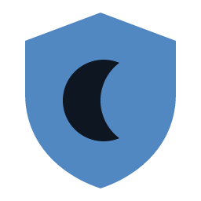

<p align="center"></p>

<h1 align="center">Sombra</h1>

<p align="center">Mensajes privados entre amigos. Cifrado de extremo a extremo, por Tor, sin teléfono ni correo.</p>

<p align="center"><a href="../../releases/latest"><b>Descargar para Windows</b></a> · <a href="https://cloudisdeaf.github.io/sombra/">Guía rápida</a> · <a href="SECURITY.md">Seguridad</a></p>

---

## Cómo funciona

```
 tu PC (crea la red)                         PC de tu amiga (se une)
 ┌───────────────────┐        Tor            ┌───────────────────┐
 │ Sombra  ◄─────────┼──── xxxx.onion ◄──────┼─ Sombra           │
 │ (servidor + app)  │                       │ (app + Tor)       │
 └───────────────────┘                       └───────────────────┘
        los mensajes viajan cifrados de un navegador al otro
```

- **Una persona crea la red.** Su ordenador hace de punto de encuentro, publicado como
  servicio oculto de Tor. La red es **solo con invitación**: para cada amigo crea un código de
  un solo uso y se lo pasas junto con la dirección `.onion` (el botón *Crear invitación y
  copiar* arma el mensaje entero).
- **El resto se une** pegando esa dirección y su código. Cada uno crea un usuario: sin teléfono ni
  correo, solo un nombre y una frase de acceso que nunca sale de su ordenador.
- **Los mensajes se cifran en tu navegador** con el protocolo de Signal (X3DH + Double
  Ratchet). Quien aloja la red solo transporta sobres cerrados: no sabe qué dicen ni quién
  los envía.
- **Todo pasa por Tor**, así que nadie ve vuestras IP, ni siquiera el anfitrión.
- **La app la ejecuta cada uno desde su propia instalación**, nunca desde el ordenador del
  anfitrión. Así nadie puede colarte código modificado.

## Uso

1. Descarga `Sombra-Setup.exe` de [Releases](../../releases/latest) y ábrelo. Se instala solo
   y se abre en tu navegador. Si Windows avisa («Windows protegió su PC»), pulsa
   **Más información → Ejecutar de todas formas**: el programa no está firmado con un
   certificado de pago.
2. Elige **Crear mi red** o **Unirme a una red**, y pega la dirección y el código si te los han pasado.
   Si eres el anfitrión puedes **cerrar el registro** cuando ya estéis todos: nadie nuevo podrá entrar, ni con código.
3. Crea tu usuario y escribe a tus amigos por su `@usuario`.
4. La primera vez que habléis, comparad el **número de seguridad**: en persona o por una
   llamada. Si coincide, nadie puede estar en medio.

> Los mensajes solo se entregan **mientras el ordenador de quien creó la red esté encendido
> y con Sombra abierto**. Tu cuenta vive en tu navegador: haz una copia de seguridad desde
> Ajustes, porque si olvidas la frase de acceso no hay forma de recuperarla.

## Compilar desde el código

Requisitos: Windows x64 y [Node.js 26](https://nodejs.org).

```bash
npm install
npm test          # 190 pruebas: criptografía, servidor, cliente, lanzador
npm run app       # ejecuta la app de escritorio sin empaquetar
npm run build     # genera dist/Sombra-Setup.exe
```

`npm run build` descarga Tor 16.0.1 y comprueba su SHA-256, fijado en
[build/build.mjs](build/build.mjs). Después genera un único ejecutable con Node.js, la app,
el servidor y Tor. Antes de compilar, pon tu enlace de descarga en `package.json`
(`sombra.downloadUrl`): es el que aparece en las invitaciones.

Para publicar una versión, sube `dist/Sombra-Setup.exe` y su `.sha256` a una *release* de
GitHub. No los subas al repositorio.

## Más información

- [SECURITY.md](SECURITY.md): modelo de amenazas, qué puede ver quien aloja la red,
  límites honestos y auditoría.
- [SPEC.md](SPEC.md): el protocolo exacto.
- [docs/AVANZADO.md](docs/AVANZADO.md): montar el servidor en un VPS o como servicio onion a
  mano.
- [THIRD-PARTY-NOTICES.md](THIRD-PARTY-NOTICES.md): licencias de Node.js, Tor y ws.
